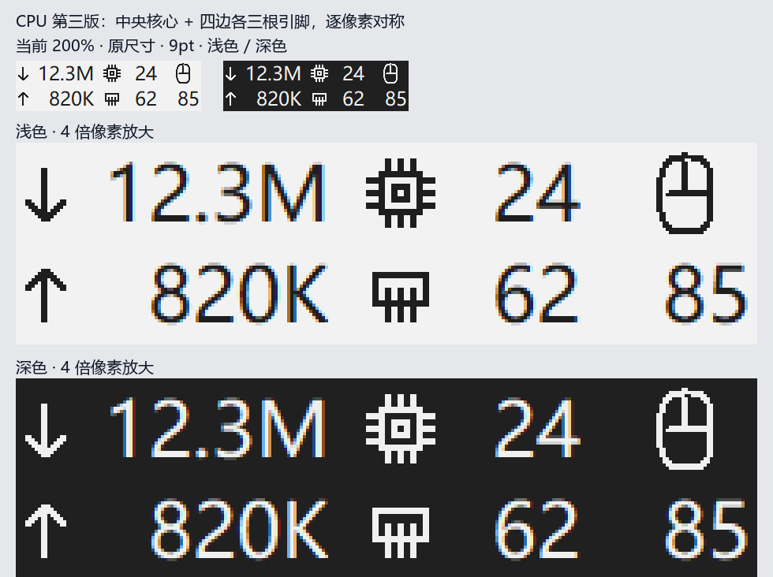

# TrafficMonitor VXE Compact Panel

用于 **TrafficMonitor 的极简数字任务栏面板**，并直接读取 **VXE R1 星闪版鼠标电量**。
只运行 TrafficMonitor，无需 BatteryMonitor、Qt、WebSocket 服务或额外采集进程。



## 功能

- 双行三列：下载 / 上传，CPU / 内存占用，鼠标轮廓 / 电量。
- 保持宿主9pt字号；数字右对齐、列宽固定，图标直接绘制，不使用emoji。
- 网速1024进位，单位`B/K/M/G`，最多一位小数；CPU、内存、电量完整保留0–100。
- 四边各三根引脚的CPU图标，按对称像素网格绘制，四档DPI验证左右/上下对称。
- 电量≤20%橙色、≤10%红色；离线`--`，未采样、错误或超过40秒过期`?`，不保留异常旧电量。
- 悬停包含五项完整名称、精确B/s、百分比和采样状态；不拦截宿主右键、双击事件。
- 原`vxe_r1_battery`单电量项目仍保留；新增自绘项目`vxe_compact_panel`，兼容原桌面皮肤。

### 实测尺寸

Windows任务栏、微软雅黑9pt、200%缩放：面板本体235×64实际像素（117.5×32逻辑像素）。
含宿主原8逻辑像素项目间距的整窗为267×64，原五项整窗435×64，宽度压缩**38.6%**。
完整尺寸矩阵与实现见[面板说明](docs/compact-panel.md)。

## 构建

需要Windows、PowerShell 7.2+、Visual Studio/MSVC C++ Build Tools及Windows SDK。

```powershell
./tools/build_traffic_plugin.ps1 -Architecture x64
# 32位宿主对应x86版本
./tools/build_traffic_plugin.ps1 -Architecture x86
```

输出：`build/traffic-compact-x64/VxeBattery.dll`（或x86目录）。
静态链接C++ runtime，生产DLL仅依赖Windows的HID、SETUPAPI、GDI32、USER32、KERNEL32。
构建过程中运行协议、格式化、字体/DPI、绘制边界及DLL接口测试，**不会进行HID查询**。

## 安装

1. 从托盘正常退出TrafficMonitor，备份原DLL及配置，确认DLL和宿主架构匹配。
2. 复制`VxeBattery.dll`到TrafficMonitor的`plugins`目录并重新启动。
3. 任务栏显示项目中仅启用“极简数字面板（网速/CPU/内存/电量）”，关闭重复网速、CPU、内存及原单电量显示。
4. 保持双行排列和9pt字号，不关闭数据采集。不要同时运行另一份鼠标电量查询程序。

这不修改TrafficMonitor主程序、鼠标设置或开机自启。
`set_compact_panel.ps1`是已有0.2安装的本地迁移/回退工具，需要本机安装记录，不是通用初次安装器。
干净环境按上述手动安装；有安装记录时见[安装/回退说明](docs/native-plugin.md)。

## 测试与离屏预览

需要Node.js；配置测试需要Python 3，构图需要Pillow。

```powershell
npm test
python -m unittest discover -s tests -p 'test_compact_config.py' -v
# 先完成C++构建，再在工作区副本验证安装事务
./tools/test_compact_switch.ps1
# 使用生产GDI绘制类生成模拟数据预览，不访问设备
./build/traffic-compact-x64/compact_preview.exe "$PWD/evidence/compact-preview"
python ./tools/compose_compact_preview.py
```

测试使用合成配置和已脱敏的原始回包，不依赖本机备份。`native_probe.exe`、`plugin_probe.exe`是实际设备诊断工具，
会执行HID查询；不要在日常宿主运行时启动。

## 验证边界与资料

- 已验证：TrafficMonitor 1.86 x64、真实85%回包、原生独立电量采集、鼠标关闭/恢复的旧单电量链路、组合面板实机尺寸。
- 未完成：新组合面板关鼠标/恢复、实时五项一致性和菜单/双击的完整用户验收、跨屏DPI迁移及长期稳定性。
- [面板布局、格式和DPI](docs/compact-panel.md)
- [独立采集、安装与回退](docs/native-plugin.md)
- [测试与硬件验证](docs/verification.md)
- [旧桥接方案](docs/traffic-display.md)（仅历史参考，不需要启动）
- [第三方来源和许可证](THIRD_PARTY_NOTICES.md)

原始抓包、机器配置、安装状态、回退备份及本机构建产物不提交到GitHub。
